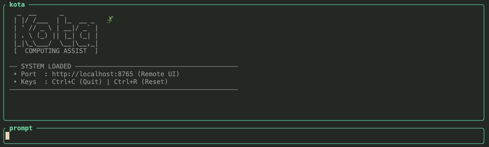
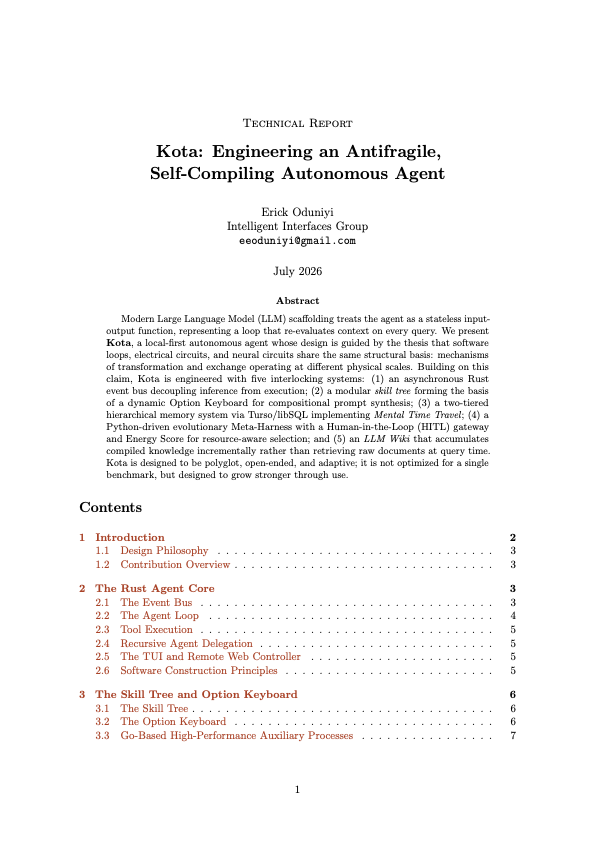

# kota 🦎

[](https://github.com/Intelligent-Interfaces/kota/actions/workflows/ci.yml)

A TUI agent coder & computing assistant that runs on local LLMs.


<p align="center">
  
</p>

## What it does

- Talks to any OpenAI-compatible local LLM (Ollama, llama-server, RamaLama, vLLM)
- **Recursive Agent (RA) Delegation**: Delegate complex sub-tasks to isolated subagents with clean context envelopes using `delegate_task` to prevent context rot (bounded recursion depth).
- **Agent-Native Documentation**: OpenWiki-style codebase context mapping (`AGENTS.md`) and automated CI synchronization.
- **8 built-in tools**: `read_file`, `write_file`, `list_dir`, `run_command`, `search`, `fetch_news`, `delegate_task`, `verify_paper` (plus MCP extensible tools).
- **Confinement & Safety**: File operations are confined to `--workdir`, shell commands execute with working directory preservation, tool calls have timeouts, and execution loops have configurable step limits.
- Streams tokens and thinking/reasoning traces in real time (including subagent tokens with `Sub[mode]>` prefix).
- Shows tool calls as they happen with per-step timing and Apple Silicon energy telemetry (`macpow`).
- Remote web controller binds to `127.0.0.1` by default (opt-in LAN with `--lan` and token authentication via `--password`).
- Tracks context budget with proactive warnings before token exhaustion.
- Single binary Rust runtime.

## Quick start

```bash
# 1. Start a local model
ollama serve
ollama pull qwen3:8b

# 2. Build and run kota
cargo run

# Or with options:
cargo run -- --model qwen3:8b --api-url http://localhost:11434/v1 --workdir ~/myproject --max-steps 50 --tool-timeout 120
```

## Keybindings

| Key         | Action             |
| ----------- | ------------------ |
| Enter       | Send message       |
| Ctrl+C      | Quit               |
| Ctrl+R      | Reset conversation |
| PageUp/Down | Scroll output      |

## Architecture

```
┌──────────┐     ┌───────────┐     ┌──────────────────────────┐
│  TUI     │◄───►│  Agent    │◄───►│  Local LLM               │
│ (ratatui)│     │  Loop     │     │  Ollama / llama-server / |
└──────────┘     └─────┬─────┘     │  vLLM (for Nemotron)     │
                       │           └──────────────────────────┘
                 ┌─────▼─────┐
                 │  Tools    │
                 │ read_file │
                 │ write_file│
                 │ list_dir  │
                 │ run_cmd   │
                 │ search    │
                 │ fetch_news│
                 │ verify_pap│
                 │ delegate  │───┐ (recursively spawns
                 └───────────┘   │  isolated sub-agents)
                       ▲         │
                       └─────────┘
```

The agent loop:

1. Build context (system prompt + conversation history)
2. Stream completion from local model
3. If model emits a tool call → execute it, append result, go to 1
4. If model emits a final message → done

All events flow through a typed channel. The TUI subscribes and renders them.

## Hardware & Inference Guide

To achieve the best latency and context stability with Kota, you must align your model selection and backend with your hardware constraints.

### 1. Local Hardware Tiers (RAM vs Context Limits)

When running models locally, memory bandwidth and VRAM/RAM capacity are your primary bottlenecks. To prevent Out-Of-Memory (OOM) errors during long agentic context windows, we strongly recommend **4-bit block quantization (e.g., `q4_K_M` GGUFs)**.
- **8GB RAM (e.g. Base M-series Mac):** Stick to highly optimized Dense models under 4B parameters.
- **16GB RAM (e.g. M1/M2 Pro):** Recommended sweet spot. Use 7B-9B parameter models. Dense architectures with Grouped-Query Attention (GQA) excel here.
- **32GB+ RAM / Dedicated GPU:** You can explore massive 27B-35B parameter Dense models or hybrid MoEs.

### 2. Backend Recommendations

Kota is backend-agnostic, but your infrastructure dictates the optimal engine:
- **Use Ollama / llama.cpp (GGUF):** If you are running on Apple Silicon (M-series) or standard consumer x86 CPUs. Ollama heavily optimizes memory mapping for quantized GGUF weights, allowing you to squeeze massive logic into tight RAM constraints.
- **Use vLLM / TensorRT-LLM:** If you are running on dedicated NVIDIA GPUs (e.g. RTX 4090s or Datacenter GPUs). These backends natively support cutting-edge architectures like Selective State Space Models (Mamba2) and provide massive throughput for unquantized BF16 execution.

### 3. Recommended Architectures by Use Case

| Primary Use Case | Recommended Architecture Type | Example Models | Best Backend |
| ---------------- | --------------------------- | -------------- | ------------ |
| **Coding & Agents** | Dense Transformer with GQA | Qwen 3 (8B), Gemma (4B-9B) | Ollama (GGUF) |
| **Multimodal & Research** | Hybrid MoE / Mamba2 | Nemotron 3 Nano Omni | vLLM (BF16) |

*To connect Kota to a custom vLLM endpoint, simply override the API URL:*
```bash
cargo run -- --model Nemotron-3-Nano-Omni-30B-A3B-Reasoning-BF16 \
  --api-url http://localhost:8000/v1 --workdir ~/myproject
```


